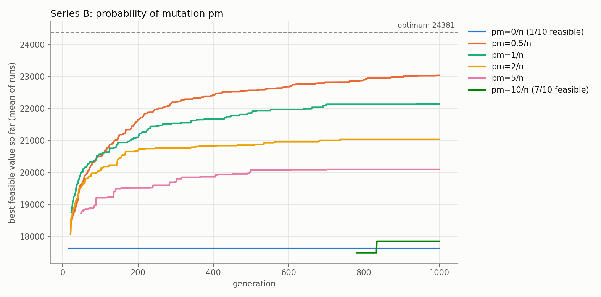
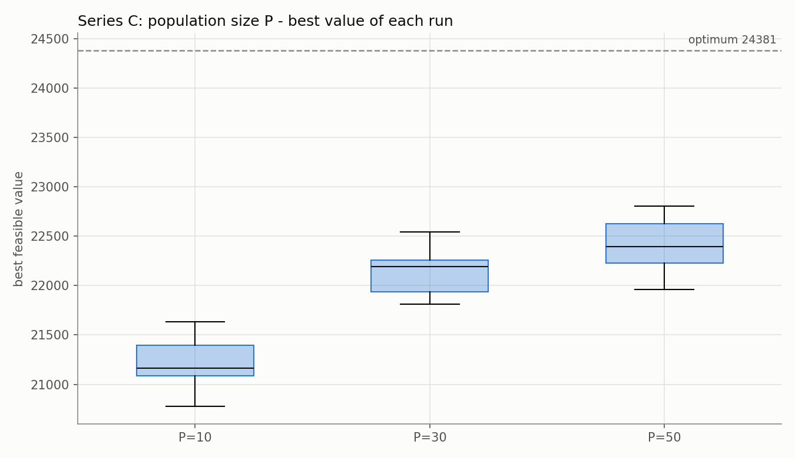
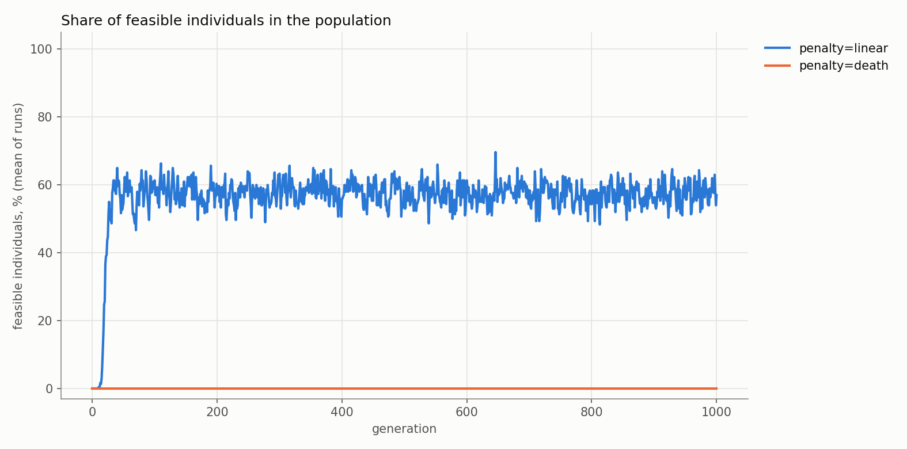
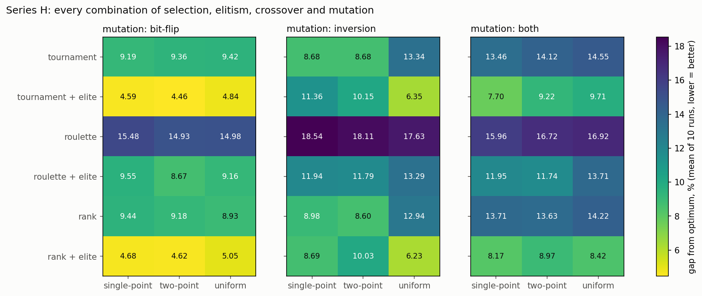
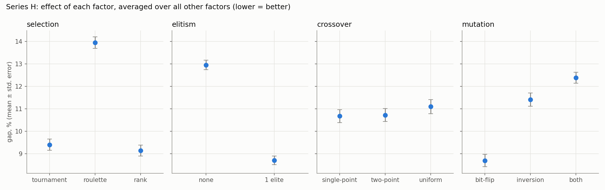
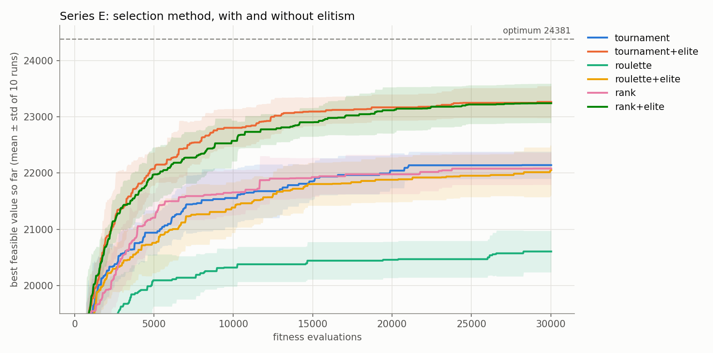
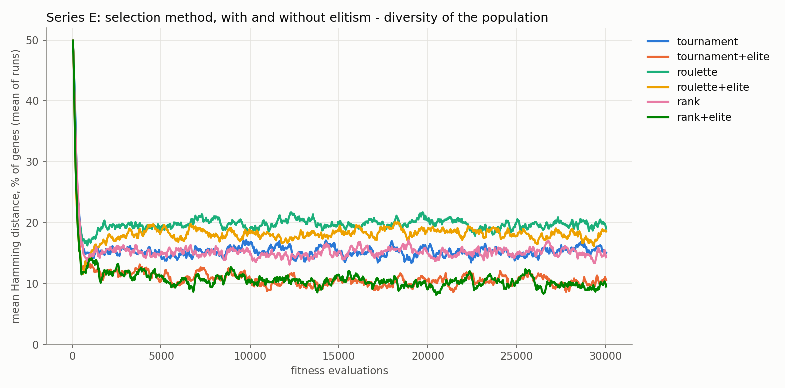
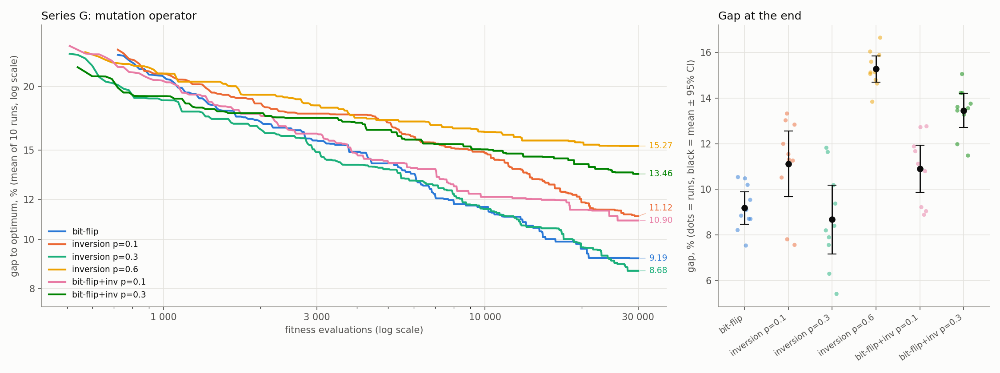
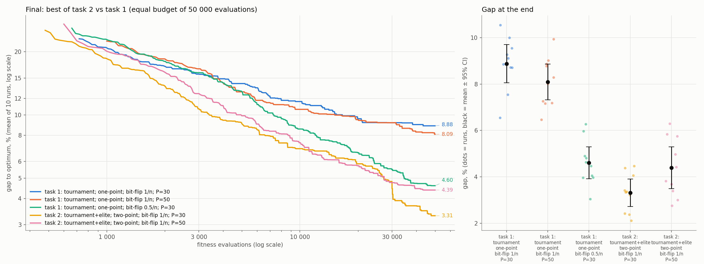

# mkp-metaheuristics

Genetic algorithm for the **multidimensional knapsack problem** (MKP,
*wielowymiarowy problem plecakowy*), written without external libraries.
Course: *Techniki inteligencji obliczeniowej*, PWr.

- **Task 1** (tag `zadanie-1`): basic GA, see [Task 1](#task-1-experiments).
- **Task 2** (tag `zadanie-2`): elitism, two more selections, two more crossovers,
  inversion mutation, and research on the best combination, see
  [Task 2](#task-2-extended-genetic-algorithm).

## Problem

Choose items with the highest total value so that for **every** constraint
(weight, volume, ...) the total weight does not exceed its capacity.
Data: OR-Library, see [`data/README.md`](data/README.md).

## Algorithm

| Element | Choice |
|---|---|
| Chromosome | binary, gene `j` = item `j` taken |
| Fitness | total value − ρ · total excess weight (linear penalty), ρ = max value / weight |
| Selection | tournament (k = 2); task 2: roulette, rank |
| Crossover | one-point, probability `pc` per pair; task 2: two-point, uniform |
| Mutation | bit-flip, probability `pm` per gene; task 2: inversion, probability per chromosome |
| Replacement | children replace the population; task 2: the `e` best parents survive (elitism) |
| Stop condition | fixed number of generations |

The answer of a run is the best **feasible** solution found in any generation.

## Code

```
pl.pwr.tio.mkp
├── genetic/     Chromosome, Individual, Codec, Problem           (independent of the knapsack)
├── selector/    Selector, TournamentSelector, RouletteSelector, RankSelector, Wheel
├── operator/    GeneticOperator, Crossover, SinglePointCrossover, TwoPointCrossover,
│                UniformCrossover, BitFlipMutator, InversionMutator
├── engine/      Engine (main loop, elitism, stream of generations), EvolutionResult
├── knapsack/    Item, KnapsackInstance, CsvInstanceReader, KnapsackCodec,
│                KnapsackProblem, Penalty, LinearPenalty, DeathPenalty
├── experiment/  ExperimentPlan (task 1), TaskTwoPlan (task 2), RunConfig,
│                SelectionType, CrossoverType, MutationType, ExperimentRunner,
│                SummaryTable, Plots
└── Main
```

## Running

Requirements: Java 21, Maven, Python 3 with `pip install -r scripts/requirements.txt`.
(`pulp` is needed only for `scripts/exact.py`.)

```
mvn package
java -cp target/classes pl.pwr.tio.mkp.Main
```

or run `Main` from the IDE (working directory = project root).

`Main` solves the toy example, runs the experiments of task 2 (10 runs each, seeds 1..10)
on `mknap1-6` (n = 50, m = 5) and `mknapcb1-0` (n = 100, m = 5), prints a summary and
calls `scripts/plots2.py`. Results go to `results/zadanie-2/<instance>/`:
`history.csv`, `runs.csv`, `summary.csv`, `summary.md`, `plots/*.png`.
About 2 minutes for 1 580 runs.

`--zadanie-1` runs the experiments of task 1 instead, into `results/<instance>/`, with
`scripts/plots.py`.

Then all plots open in one window (arrow keys switch between them); the program ends
when the window is closed.

Options: `--no-plots` skips Python; `-Dpython=python3` sets the Python command.

## Task 1: experiments

Base configuration: P = 30, G = 1000, tournament 2, pc = 0.9, pm = 1/n, linear penalty.

| Series | Changed parameter |
|---|---|
| A | pc ∈ {0, 0.5, 0.7, 0.9, 1} |
| B | pm ∈ {0, 0.5, 1, 2, 5, 10} / n |
| C | P ∈ {10, 30, 50} |
| D | linear penalty vs death penalty |

All 16 configurations are listed one per line in
[`ExperimentPlan.java`](src/main/java/pl/pwr/tio/mkp/experiment/ExperimentPlan.java).

## Task 1: results

Gap = (optimum − mean best value of 10 runs) / optimum. No configuration reached the
optimum in any run.

| Series | Best setting | Gap, `mknap1-6` (n = 50) | Gap, `mknapcb1-0` (n = 100) |
|---|---|---|---|
| base | P = 30, pc = 0.9, pm = 1/n | 0.91 % | 9.19 % |
| A: crossover | pc = 0.9 | 0.91 % | 9.19 % |
| B: mutation | pm = 1/n (n = 50), 0.5/n (n = 100) | 0.91 % | 5.50 % |
| C: population | P = 50 | 0.60 % | 8.09 % |
| D: penalty | linear | 0.91 % | 9.19 % (death: no feasible solution) |







The plots are for `mknapcb1-0`; all plots and full tables are written to `results/` by `Main`.

Conclusions:

- **Mutation matters most.** Without mutation (pm = 0) the population converges in a few
  generations (gap 7.1 % and 27.7 %, only 1 of 10 runs feasible on `mknapcb1-0`).
  Too much mutation turns the search into a random walk (pm = 10/n: gap 4.6 % and 26.8 %).
  On the larger instance pm = 0.5/n is clearly better than the usual 1/n.
- **Crossover probability matters little.** All values of pc give similar results
  (gap 0.9–1.1 % and 9.2–10.2 %); no crossover at all is the worst on `mknapcb1-0`.
- **Larger population helps.** P = 10 → 50 lowers the gap from 2.7 % to 0.6 % and from
  13.0 % to 8.1 %, at the cost of more fitness evaluations.
- **Linear penalty beats death penalty.** On `mknapcb1-0` the random initial population has
  no feasible individual; the death penalty gives all of them the same fitness, so selection
  has no direction and no feasible solution is ever found. The linear penalty lets the
  population move from infeasible to feasible solutions (about 60 % feasible after
  ~40 generations).
- The basic GA (no elitism, no repair, no local search) gets within 1 % of the optimum
  for n = 50, but stays 5–9 % below it for n = 100.

Tests: `mvn test`.

## Task 2: extended genetic algorithm

### What was added

| Element | Class | PR |
|---|---|---|
| Elitism: the `e` best parents replace the `e` worst children | `Engine` | [#1](../../pull/1) |
| Roulette selection: chance ∝ fitness − min (fitness can be negative because of the penalty) | `RouletteSelector` | [#2](../../pull/2) |
| Rank selection: linear ranking, pressure s = 2, chance depends only on the place | `RankSelector` | [#2](../../pull/2) |
| Two-point crossover: swap the middle part | `TwoPointCrossover` | [#3](../../pull/3) |
| Uniform crossover: every gene from a random parent | `UniformCrossover` | [#3](../../pull/3) |
| Inversion: reverse a random segment, the number of taken items in it stays the same | `InversionMutator` | [#4](../../pull/4) |
| Choice of methods per configuration, diversity of the population | `RunConfig`, `EvolutionResult.diversity` | [#5](../../pull/5) |
| Experiments E–H, plots | `TaskTwoPlan`, `scripts/plots2.py` | [#6](../../pull/6) |
| Tuning, final comparison, significance tests | `TaskTwoPlan`, `scripts/plots2.py` | [#7](../../pull/7) |

The engine did not change except for elitism: a new method is a new class implementing
`Selector` or `GeneticOperator`. All changes since task 1:
[`zadanie-1...zadanie-2`](../../compare/zadanie-1...zadanie-2).

### Experiments

Base = task 1: P = 30, G = 1000, tournament, no elites, one-point crossover pc = 0.9,
bit-flip pm = 1/n, linear penalty. 10 runs per configuration. In series E–I every
configuration has the same budget of 30 030 fitness evaluations, so the x axis of the
convergence plots is the number of evaluations.

| Series | What changes |
|---|---|
| E | selection (tournament, roulette, rank) × elitism (0 or 1 elite) |
| F | crossover (none, one-point, two-point, uniform; pc of uniform) |
| G | mutation (bit-flip, inversion p = 0.1 / 0.3 / 0.6, both) |
| H | all 54 combinations: 3 selections × 2 elitism × 3 crossovers × 3 mutations |
| I | parameters of the winner of H: number of elites, pm, pc |
| Z | final: task 1 vs task 2, equal budget of about 50 000 evaluations |

Measures: gap = (optimum − mean best value) / optimum, std, best run, generation of the
best value, diversity of the population (mean Hamming distance between two individuals,
% of genes) and the Mann–Whitney U test (p < 0.05 = the difference is larger than the
random spread of 10 runs). Full tables: `results/zadanie-2/<instance>/summary.md`.

### Results

Gap, % (mean of 10 runs), `mknap1-6` (n = 50) / `mknapcb1-0` (n = 100):

| Series | Configuration | n = 50 | n = 100 |
|---|---|---|---|
| E | tournament / + elite | 0.91 / **0.69** | 9.19 / **4.59** |
| E | roulette / + elite | 3.45 / 0.88 | 15.48 / 9.55 |
| E | rank / + elite | 0.94 / 0.75 | 9.44 / 4.68 |
| F | no crossover / one-point / two-point / uniform | 0.98 / 0.91 / 0.79 / 2.73 | 10.23 / 9.19 / 9.36 / 9.42 |
| G | bit-flip / inversion p=0.3 / both | 0.91 / 2.29 / 1.93 | 9.19 / 8.68 / 13.46 |
| H | best combination | 0.50 (rank + elite, uniform, bit-flip) | 4.46 (tournament + elite, two-point, bit-flip) |
| Z | best of task 1 (equal budget) | 0.60 | 4.60 |
| Z | **task 2: tournament + 1 elite, two-point, bit-flip 1/n, pc 0.9** | **0.55** | **3.31** |













The plots are for `mknapcb1-0`; all plots are written to `results/zadanie-2/` by `Main`.

Conclusions:

- **Elitism matters most.** One elite halves the gap on n = 100 for every selection
  (9.19 → 4.59 % for tournament, p = 0.0002). Without it the best individual is often
  destroyed by mutation and its genes are lost. On n = 50 the effect is smaller and
  significant only for roulette.
- **Tournament ≈ rank, roulette is the worst.** Tournament and rank depend only on the
  order of individuals and give the same results (p = 0.38). Roulette depends on the
  values: with the penalty, one bad individual makes all the others almost equal, so the
  pressure is weak. Its population stays the most diverse (~20 % of genes vs ~15 %) and the
  gap is the largest (15.5 %). Elitism helps roulette the most.
- **The type of crossover hardly matters**, as pc in task 1. The expected advantage of
  uniform crossover (the order of items is arbitrary) did not appear: on n = 100 the three
  operators differ by 0.2 percentage points, on n = 50 uniform crossover had one very bad
  run. The diversity plot shows why crossover has little to work with: after about
  1 000 evaluations two individuals differ in only ~15 % of genes.
- **Bit-flip is the best mutation.** Inversion alone keeps the number of taken items in
  the segment, so it cannot add or remove items; it is better than bit-flip only on n = 100
  with p = 0.3. Both together mutate too much (diversity ~27 %) and are worse than each
  alone, the same effect as a too large pm in task 1.
- **The best methods taken one by one are not the best together.** Winners of E, F and G
  on n = 100 (tournament + elite, one-point, inversion p = 0.3) are only 31st of 54 in
  series H (11.36 %): inversion does not work well with elitism. So the factors interact
  and the full series H is needed. The best combinations differ only within the random
  spread (p = 0.97 for the top two).
- **Tuning (series I).** One elite is best: e = 5 lowers the diversity to 3 % and the gap
  grows to 5.16 %. With elitism pm = 1/n is better than 0.5/n (4.46 vs 5.14 %), while
  without elitism (task 1) 0.5/n was better: the elite keeps the best individual, so more
  mutation can be afforded. pc changes little.
- **Task 2 vs task 1.** With the same budget of 50 000 evaluations the task 2 algorithm is
  better than every configuration of task 1 on n = 100 (3.31 % vs 4.60 %, p = 0.013) and
  as good as the best one on n = 50 (0.55 % vs 0.60 %, not significant). Its best run is
  1.6 % (n = 100) and 0.08 % (n = 50) from the optimum, but the optimum itself was still
  not reached.

## License

[MIT](LICENSE)
