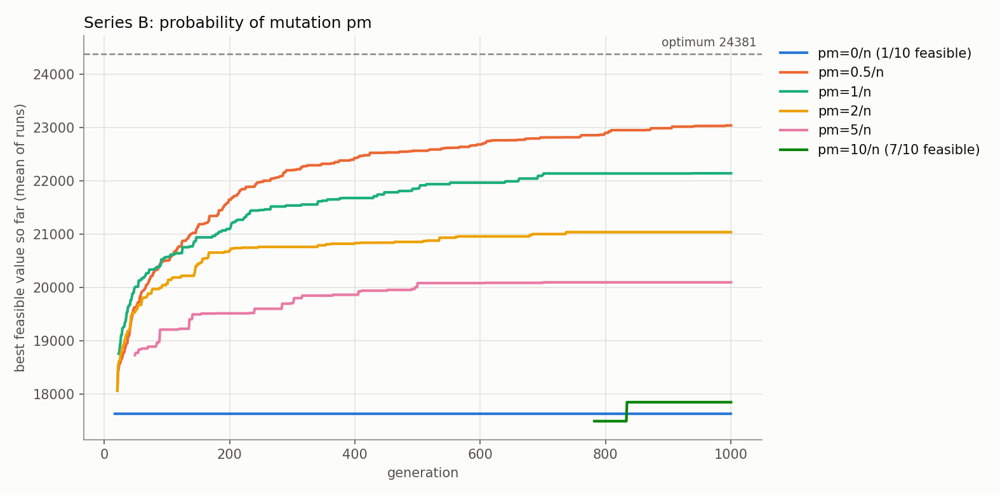
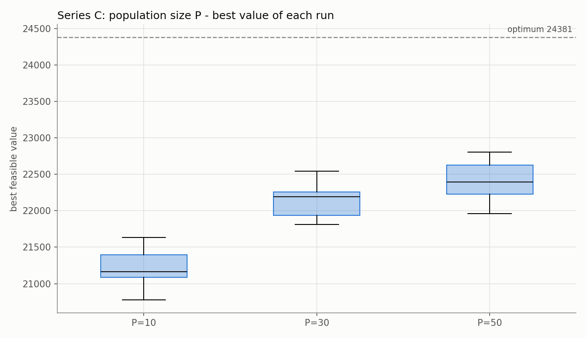
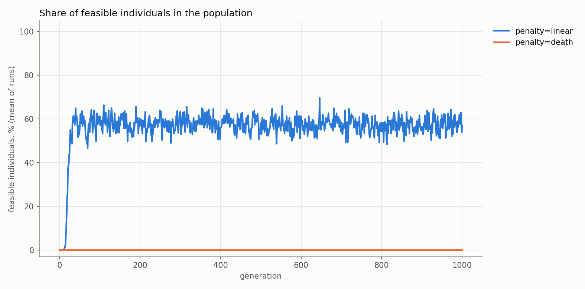

# mkp-metaheuristics

Basic genetic algorithm for the **multidimensional knapsack problem** (MKP,
*wielowymiarowy problem plecakowy*), written without external libraries.
Course: *Techniki inteligencji obliczeniowej*, PWr, task 1.

## Problem

Choose items with the highest total value so that for **every** constraint
(weight, volume, ...) the total weight does not exceed its capacity.
Data: OR-Library, see [`data/README.md`](data/README.md).

## Algorithm

| Element | Choice |
|---|---|
| Chromosome | binary, gene `j` = item `j` taken |
| Fitness | total value − ρ · total excess weight (linear penalty), ρ = max value / weight |
| Selection | tournament, size 2 |
| Crossover | one-point, probability `pc` per pair |
| Mutation | bit-flip, probability `pm` per gene |
| Replacement | whole population replaced by children (no elitism) |
| Stop condition | fixed number of generations |

The answer of a run is the best **feasible** solution found in any generation.

## Code

```
pl.pwr.tio.mkp
├── genetic/     Chromosome, Individual, Codec, Problem           (independent of the knapsack)
├── selector/    Selector, TournamentSelector
├── operator/    GeneticOperator, Crossover, SinglePointCrossover, BitFlipMutator
├── engine/      Engine (main loop, stream of generations), EvolutionResult
├── knapsack/    Item, KnapsackInstance, CsvInstanceReader, KnapsackCodec,
│                KnapsackProblem, Penalty, LinearPenalty, DeathPenalty
├── experiment/  ExperimentPlan, RunConfig, ExperimentRunner, SummaryTable, Plots
└── Main
```

## Running

Requirements: Java 21, Maven, Python 3 with `pip install -r scripts/requirements.txt`.
(`pulp` is needed only for `scripts/exact.py`.)

```
mvn package
java -cp target/classes pl.pwr.tio.mkp.Main
```

or run `Main` from the IDE (working directory = project root).

`Main` solves the toy example, runs all experiment series (10 runs each, seeds 1..10)
on `mknap1-6` (n = 50, m = 5) and `mknapcb1-0` (n = 100, m = 5), prints a summary and
calls `scripts/plots.py`. Results go to `results/<instance>/`:
`history.csv`, `runs.csv`, `summary.csv`, `summary.md`, `plots/*.png`.

Then all plots open in one window (arrow keys switch between them); the program ends
when the window is closed.

Options: `--no-plots` skips Python; `-Dpython=python3` sets the Python command.

## Experiments

Base configuration: P = 30, G = 1000, tournament 2, pc = 0.9, pm = 1/n, linear penalty.

| Series | Changed parameter |
|---|---|
| A | pc ∈ {0, 0.5, 0.7, 0.9, 1} |
| B | pm ∈ {0, 0.5, 1, 2, 5, 10} / n |
| C | P ∈ {10, 30, 50} |
| D | linear penalty vs death penalty |

All 16 configurations are listed one per line in
[`ExperimentPlan.java`](src/main/java/pl/pwr/tio/mkp/experiment/ExperimentPlan.java).

## Results

Gap = (optimum − mean best value of 10 runs) / optimum. No configuration reached the
optimum in any run.

| Series | Best setting | Gap, `mknap1-6` (n = 50) | Gap, `mknapcb1-0` (n = 100) |
|---|---|---|---|
| base | P = 30, pc = 0.9, pm = 1/n | 0.91 % | 9.19 % |
| A: crossover | pc = 0.9 | 0.91 % | 9.19 % |
| B: mutation | pm = 1/n (n = 50), 0.5/n (n = 100) | 0.91 % | 5.50 % |
| C: population | P = 50 | 0.60 % | 8.09 % |
| D: penalty | linear | 0.91 % | 9.19 % (death: no feasible solution) |







The plots are for `mknapcb1-0`; all plots and full tables are written to `results/` by `Main`.

Conclusions:

- **Mutation matters most.** Without mutation (pm = 0) the population converges in a few
  generations (gap 7.1 % and 27.7 %, only 1 of 10 runs feasible on `mknapcb1-0`).
  Too much mutation turns the search into a random walk (pm = 10/n: gap 4.6 % and 26.8 %).
  On the larger instance pm = 0.5/n is clearly better than the usual 1/n.
- **Crossover probability matters little.** All values of pc give similar results
  (gap 0.9–1.1 % and 9.2–10.2 %); no crossover at all is the worst on `mknapcb1-0`.
- **Larger population helps.** P = 10 → 50 lowers the gap from 2.7 % to 0.6 % and from
  13.0 % to 8.1 %, at the cost of more fitness evaluations.
- **Linear penalty beats death penalty.** On `mknapcb1-0` the random initial population has
  no feasible individual; the death penalty gives all of them the same fitness, so selection
  has no direction and no feasible solution is ever found. The linear penalty lets the
  population move from infeasible to feasible solutions (about 60 % feasible after
  ~40 generations).
- The basic GA (no elitism, no repair, no local search) gets within 1 % of the optimum
  for n = 50, but stays 5–9 % below it for n = 100.

Tests: `mvn test`.

## License

[MIT](LICENSE)
